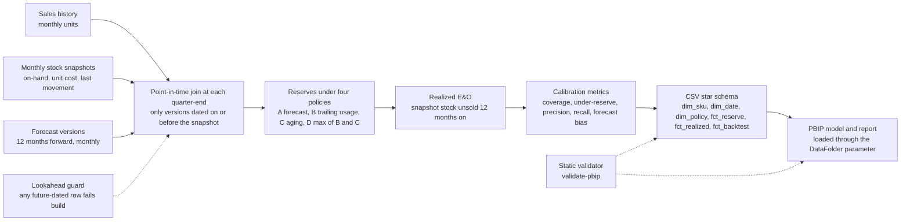

# eobacktest

[](https://github.com/SlateGitOrg/eobacktest/actions/workflows/ci.yml)


eobacktest computes excess and obsolete (E&O) inventory reserves under four policies, replays each policy at every past quarter-end using only the stock, sales and forecast version known on that date, and scores it against the stock that actually went unsold over the next 12 months. The reference logic is DuckDB SQL with an as-of snapshot parameter. Results are exported as a CSV star schema that a Power BI project (PBIP: TMDL semantic model plus a PBIR-legacy report) loads, and a static validator checks that project without Power BI installed. All data is synthetic, produced by a seeded generator in this repository.

## The problem

A consumer-electronics accessories brand (phone cases, chargers, cables) carries 400 SKUs whose demand dies when the phone model they fit is discontinued. Each quarter, supply chain and finance reserve stock beyond 12 months of forecast coverage. Planners keep end-of-life forecasts high, so the reserve stays low until a large write-off lands in one quarter. Nobody checks whether past reserves predicted the write-offs that followed.

This project makes that check. It asks which of four reserve rules, run on the information available at each quarter-end, came closest to the E&O that was realized afterwards, and why the forecast-based rule fails (measured forecast bias by lifecycle stage).

## How it works



The four policies, per SKU at each quarter-end:

| Policy | Reserve |
|---|---|
| A, forecast coverage | Units on hand beyond the 12-month forecast of the version current at the snapshot, at 100% of cost |
| B, trailing usage | Units beyond 12 x the trailing 6-month average usage, at 100% of cost |
| C, aging | No movement for more than 180 days reserves 50%; more than 365 days reserves 100% |
| D | The larger of the B and C reserve dollars |

Realized E&O for a SKU-snapshot is `max(0, on-hand - units sold in the next 12 months) x unit cost`. Sell-through consumes the snapshot stock first, which is a stated simplification (see Design decisions).

Backtest metrics per policy and quarter-end: reserve $, realized $, coverage ratio (reserve / realized), under-reserve $ (the sum over SKUs of `max(0, realized - reserve)`), and flag precision and recall (reserve > 0 against realized > 0). Forecast bias is the sum of forecast units over the sum of actual units, minus one, for every monthly forecast version against the month it predicted, grouped by the lifecycle stage of the target month.

## Quick start

Python 3.11 or later.

```bash
python -m venv .venv && source .venv/bin/activate
pip install -e ".[dev]"

eobacktest generate --seed 7 --out data/      # synthetic SKUs, snapshots, forecasts, sales, scrap
eobacktest build --data data/                 # replay every quarter-end; runs the lookahead guard
eobacktest backtest                           # calibration per policy and forecast bias by stage
eobacktest export --out powerbi/data          # star-schema CSVs for the Power BI model
eobacktest validate-pbip                      # static checks on powerbi/EOBacktest.pbip
eobacktest report --out out/report.md         # Markdown tables, including the end-of-life cohorts
pytest -q
```

To open the report in Power BI Desktop, open `powerbi/EOBacktest.pbip` and set the `DataFolder` parameter (Transform data, Manage parameters) to the absolute path of `powerbi/data`. The CSVs for seed 7 are checked in. The Backtest Calibration page is filtered to `dim_date[is_scored] = 1` so its reserve, realized, coverage and under-reserve columns cover the same seven quarter-ends. The SKU Drill page has single-select slicers preselected to quarter-end 2024 Q4 and Policy D, so per-SKU reserves are not summed across policies or snapshots, and Reserve Trend plots months of supply by quarter-end, so stock is never added up across snapshots. `python -m eobacktest.pbip_writer powerbi` regenerates the project files from the schema and measure registry in `src/eobacktest/schema.py` and `registry.py`.

## Example output

Produced by running the commands above on seed 7.

```text
$ eobacktest build --data data/
replayed 11 quarter-ends (7 scored): 4,101 positions, 16,404 reserve rows, 2,501 realized rows; lookahead guard returned 0 rows
```

Backtest calibration, all seven scored quarter-ends (June 2023 to December 2024). Reserve $, realized $ and under-reserve $ are sums over seven snapshots whose 12-month windows overlap, so the same unsold stock can appear in several quarter-ends; read them as calibration totals, not as annual write-off amounts. Policies D and B are identical by construction (see Design decisions):

| Policy | Reserve $ | Realized $ | Coverage ratio | Under-reserve $ | Precision | Recall |
|---|---|---|---|---|---|---|
| A | $69,358 | $1,074,216 | 0.065 | $1,004,858 | 100.0% | 65.3% |
| B | $2,795,091 | $1,074,216 | 2.602 | $187,609 | 41.7% | 68.9% |
| C | $965,545 | $1,074,216 | 0.899 | $234,539 | 67.7% | 53.6% |
| D | $2,795,091 | $1,074,216 | 2.602 | $187,609 | 41.7% | 68.9% |

Realized E&O does not depend on the policy, so in the Power BI calibration table every policy row shows the same realized value.

Forecast bias by lifecycle stage of the target month. The dormant row has no sales to divide by; the dormant-SKU forecast is planted (see Design decisions), so a low Policy A reserve on those SKUs is not an independent finding:

| Lifecycle stage | SKU-months | Forecast units | Actual units | Bias |
|---|---|---|---|---|
| ramp | 408 | 55,424 | 37,818 | +46.6% |
| mature | 109,602 | 14,544,868 | 14,532,596 | +0.1% |
| decline | 9,360 | 791,530 | 69,456 | +1039.6% |
| dormant | 5,310 | 559,710 | 0 | n/a (no sales) |

End-of-life cohort for phone model P-07 (30 SKUs, discontinued August 2024), reserve by policy at each quarter-end:

| Quarter-end | On hand $ | Reserve A | Reserve B | Reserve C | Reserve D | Realized E&O $ | Scrapped next quarter $ |
|---|---|---|---|---|---|---|---|
| 2023-06-30 | $60,203 | $0 | $0 | $0 | $0 | $0 | $0 |
| 2023-09-30 | $68,117 | $0 | $0 | $0 | $0 | $0 | $0 |
| 2023-12-31 | $59,733 | $0 | $0 | $0 | $0 | $0 | $0 |
| 2024-03-31 | $54,012 | $0 | $0 | $0 | $0 | $336 | $0 |
| 2024-06-30 | $61,341 | $0 | $0 | $0 | $0 | $25,582 | $0 |
| 2024-09-30 | $91,821 | $0 | $0 | $0 | $0 | $86,945 | $0 |
| 2024-12-31 | $100,455 | $12,467 | $27,351 | $0 | $27,351 | $100,026 | $0 |
| 2025-03-31 | $100,026 | $35,046 | $90,273 | $0 | $90,273 | n/a | $49,975 |
| 2025-06-30 | $50,051 | $4,497 | $49,192 | $0 | $49,192 | n/a | $0 |
| 2025-09-30 | $50,051 | $16,070 | $50,051 | $0 | $50,051 | n/a | $50,051 |
| 2025-12-31 | $0 | $0 | $0 | $0 | $0 | n/a | $0 |

At the first quarter-end after the discontinuation (2024-09-30) no policy reserves anything against $86,945 of stock that will not sell. At the second (2024-12-31) Policy A reserves $12,467 against $100,026 realized, and Policy B reserves more than Policy A. The stock is scrapped in the two quarters that follow (June and October 2025). Realized E&O is blank from 2025-03-31 on because fewer than 12 months of sales follow those dates.

## Design decisions

**Point-in-time by construction, plus a guard.** `sql/position.sql` is the only query that reads dated data. It takes the snapshot date as `$snap`, picks each SKU's latest forecast version with `version_date <= $snap`, and reads sales only up to the snapshot month. The reserve queries are pure functions of its output. A separate query lists position rows whose forecast version is dated after their snapshot, and `build` fails if it returns anything. The generator plants a zero-forecast version dated after the last snapshot for 12 P-07 SKUs; a test drops the date filter and shows the guard catching it and Policy A looking much better on those SKUs. The cost is one extra table and a loop of 11 snapshot queries instead of one set-based query.

**Realized E&O treats snapshot stock as sold first.** Units sold in the next 12 months are netted against the snapshot's on-hand without tracking which units are which, and scrap and later purchases are ignored. That is first-in-first-out, and it understates realized E&O for a SKU whose later purchases are the ones that sell. It was chosen because it needs no lot tracking and is easy to state. Scrap is reported next to the reserves rather than deducted, because it is the write-off the reserves are meant to anticipate.

**D equals B, structurally, and the table shows what that costs.** Policy D is the larger of B and C in dollars. C is positive only when a SKU has had no movement for more than 180 days, which means no sale in the trailing six months, which means zero trailing usage, which makes B a 100% reserve. So B is at least C whenever C is positive, and D equals B for every SKU at every quarter-end (a test asserts it); D is not a separate result. D has the lowest under-reserve (tied with B), but its precision is 41.7%: trailing usage reserves seasonal gift packs after their season ends. Choosing a policy on under-reserve alone would pick the rule that over-reserves most; the calibration table keeps coverage ratio and precision next to it for that reason.

**Dormant SKUs carry a forecast equal to a year of their stock.** The 15 dormant SKUs sell nothing but keep a forecast of 85-100% of stock divided by 12 per month, so Policy A reserves about 7% of their stock. A forecast of 20 units a month against 800-2,000 units on hand would make Policy A reserve 70-88% of them, which is not the failure the backtest is meant to expose. The trade-off is that the generated forecast encodes the conclusion: the test that Policy A reserves at most 25% of dormant stock (and B at least 90%) checks the planted forecast, not an independent finding. The forecast bias table reports these SKUs as having no sales rather than a percentage.

**Quarter-ends start at month 6 and only seven can be scored.** The first quarter-end with a full six-month usage window in the data is June 2023. Realized E&O needs 12 forward months, so December 2024 is the last scored quarter-end. Later quarter-ends keep their reserves but show blank realized values, and the P-09 discontinuation (April 2025) is visible only in reserves and scrap.

**The Power BI project is validated statically and by evaluation.** Power BI cannot run in CI, so `validate-pbip` parses the TMDL and `report.json`, checks every column against the CSV headers, every DAX reference, relationship key uniqueness and orphans, and every visual binding, and requires the measure set to equal the registry. A small DAX reader also evaluates each measure over the exported CSVs, and a test compares the result with the reference SQL. This does not prove that Power BI Desktop accepts every property or that filter-context behavior matches; it proves the names, references and arithmetic.

## Testing

```bash
pytest -q
```

90 tests, offline. One caveat on what they prove: the dormant-SKU assertions (Policy A at most 25%, Policy B at least 90%) restate how the data was planted and are regression checks, not evidence about real inventory. The tests cover the hand-computed policy fixtures (SKU1, SKU2 and SKU3 at one snapshot), the realized E&O fixture (1,000 on hand, 650 sold, 350 unsold), the as-of and lookahead behavior (including a deliberately leaky join), the recovery of every injected pattern in the generated data (P-07 and P-09 end-of-life, dormant SKUs, seasonal gift packs, forecast bias by stage), agreement between the SQL and a plain-Python restatement of each policy on all 16,404 reserve rows, the validator's failure modes, an evaluator test that the Calibration table's reserve, realized, coverage, under-reserve, precision and recall reconcile per policy under the page's filters, and the CLI end to end.

## Project layout

```text
src/eobacktest/
  config.py          calendar, policies, scored quarter-ends
  generate.py        seeded generator and injected patterns
  db.py              DuckDB schema, CSV loading, as-of queries, lookahead guard
  sql/               schema, position, reserves, realized, lookahead, backtest, bias
  policies.py        plain-Python restatement of the four policies
  backtest.py        calibration, forecast bias and cohort views
  schema.py          star schema: columns and export queries
  registry.py        the eight measures: DAX and SQL reference
  export.py          CSV star-schema export
  pbip_writer.py     writes the TMDL model and PBIR-legacy report
  pbip_validate.py   static validation of the Power BI project
  dax.py             reader and evaluator for the DAX subset in use
  report.py          Markdown report
  cli.py             generate, build, backtest, export, validate-pbip, report
powerbi/
  EOBacktest.pbip
  EOBacktest.SemanticModel/   definition/ with database, model, relationships, expressions, tables
  EOBacktest.Report/          definition.pbir and report.json (Reserve Trend, Backtest Calibration, SKU Drill)
  data/                       star-schema CSVs for seed 7
tests/                        policies, lookahead, generator, backtest, pbip, cli
.github/workflows/ci.yml
```

## License

MIT. See `LICENSE`.
